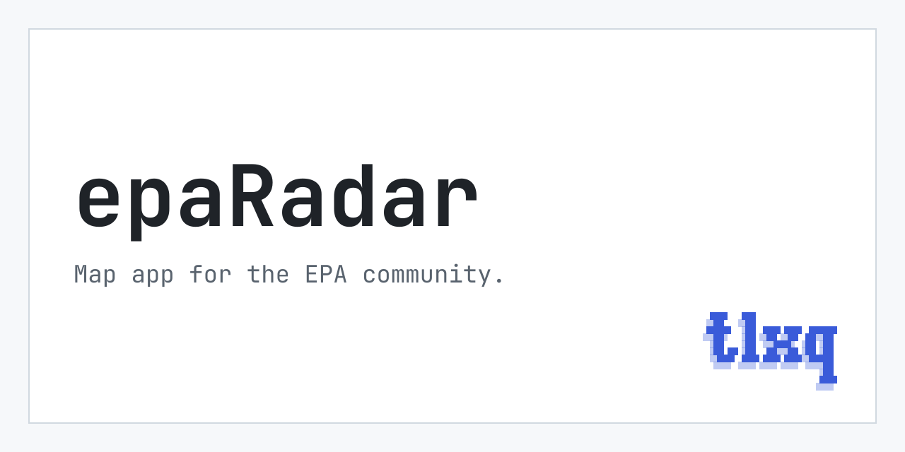
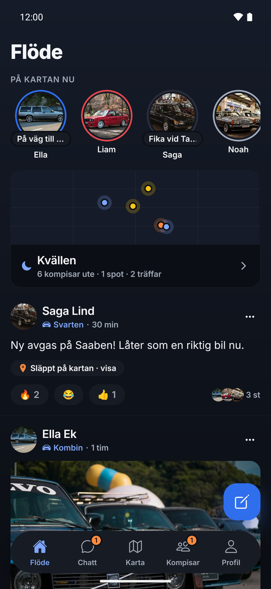
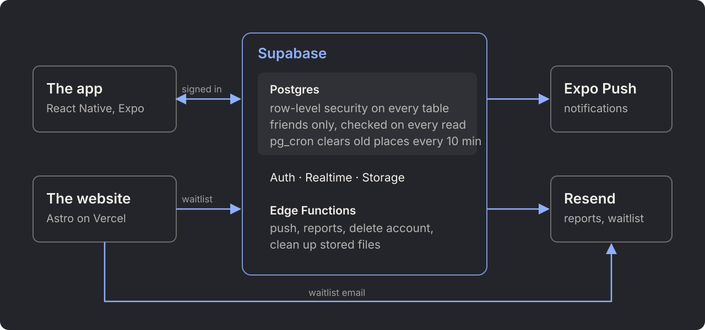

<picture>
  <source media="(prefers-color-scheme: dark)" srcset="docs/assets/banner-dark.svg">
  
</picture>

Friends on a live map. Only friends see where you are. A Swedish app for young drivers of EPA and
A-traktor cars: add friends, share where you are with them only, and plan meetups.

[eparadar.se](https://eparadar.se) · in development, on its way to Google Play and the App Store

<!-- Screenshots: from the demo data (made-up people around Södermalm), made by `mise run pictures`. -->
<p align="center">
  
  
  
</p>

## Why it exists

Young drivers of EPA and A-traktor cars meet up in parking lots and drive together. They plan it in
group chats and on maps made for everyone. epaRadar does one thing: shows which friends are out,
where the meetup is and who is coming. It is my degree project, built on my own.

## What was hard

Most people who use it are 15 to 17, and the app shows where they are. Rules in the app can be
taken apart, so the rules live in the database instead.

- Location is off until you turn it on, and then only accepted friends see it. A row-level security
  policy in Postgres checks the friendship on every read, so a changed app or the public anon key
  gets nothing more. Someone who is not a friend sees a name and a picture, nothing else.
- Everything that shows where someone is or was runs out on the server: a position after 12 hours,
  a status after 1 hour, a warning after 2 hours, other spots after 24 hours, a meetup a day after it
  starts. A `pg_cron` job clears them every 10 minutes.
- 511 pgTAP tests cover every table and function, each with a case for someone logged out and for
  someone who is not a friend. 168 Jest tests cover the app's logic, and 8 Maestro flows click
  through the main tasks on an Android emulator. The tests run before every merge, the flows for
  every change to the app's screens.
- Other people's posts, photos and messages can be reported, and anyone can be blocked.

## How it fits together

<p align="center"></p>

## Stack

React Native with Expo · Supabase (Postgres, row-level security, Realtime, Edge Functions, pgTAP) ·
Astro on Vercel · TypeScript · Maestro

## Run it

With made-up users on a local database. You need [mise](https://mise.jdx.dev), Docker and an
Android phone or emulator.

```sh
mise install
mise exec -- npm ci
mise exec -- supabase start
cp apps/mobile/.env.example apps/mobile/.env
mise exec -- npm run phone
```

Put the local URL and anon key from `supabase status` in `apps/mobile/.env`, then sign in as
`test@test.se` with the password `testtest`. The demo data has ten made-up people around Södermalm
in Stockholm, with cars, posts, meetups and chats. `mise run check` runs lint, types and unit tests,
`mise exec -- supabase test db --local` runs the database tests, and `mise run e2e` runs the Maestro
flows. Everything else is in [docs/development.md](docs/development.md).

## Licence

All rights reserved. You may read the code, but not copy or reuse it.
